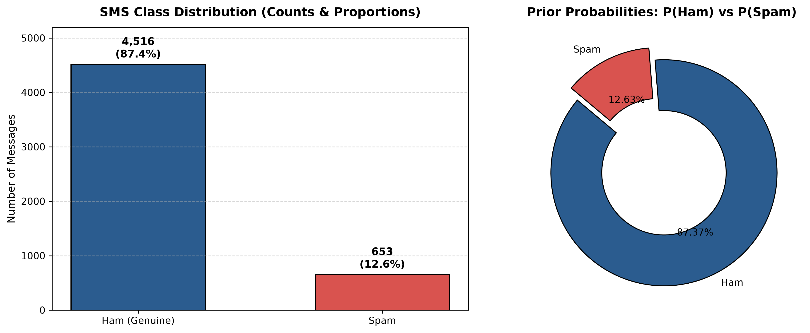
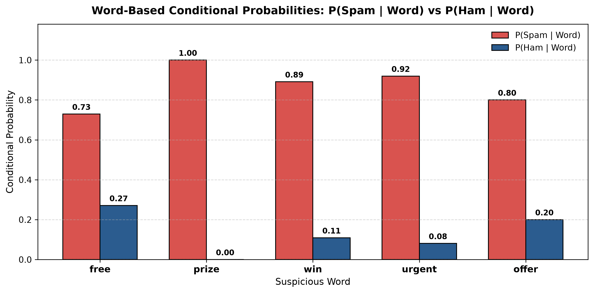
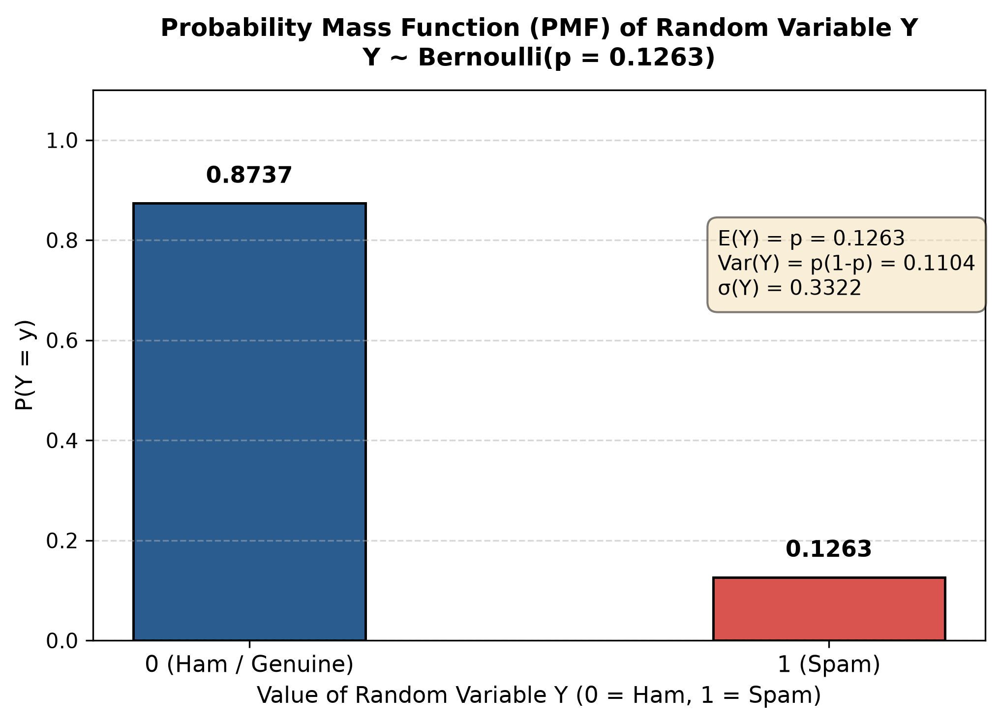
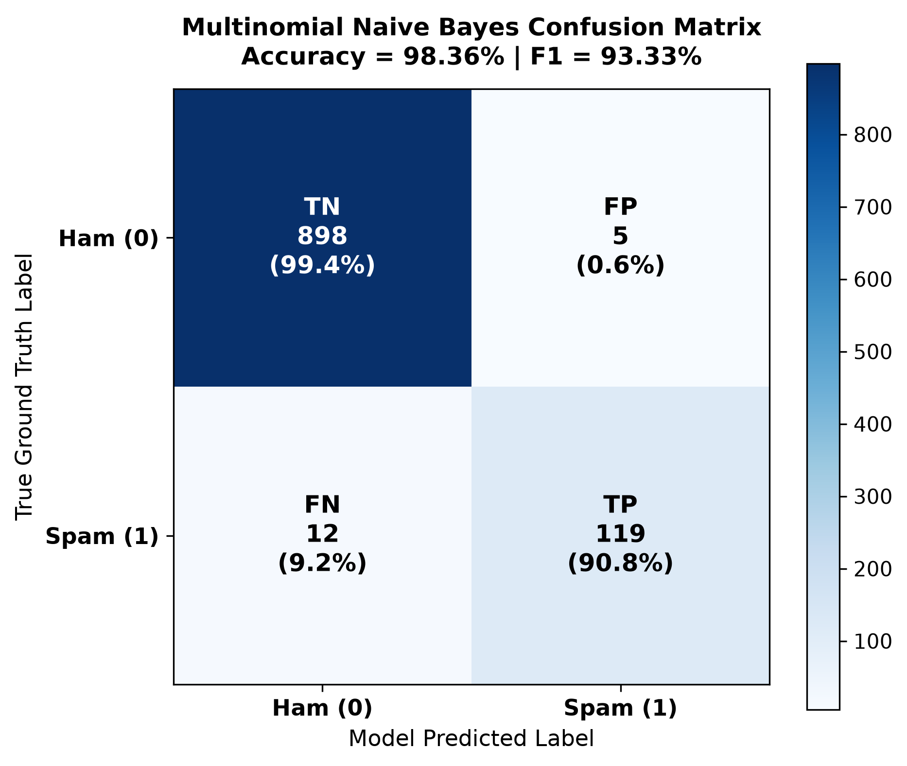

# Probabilistic SMS Spam Detection
### BAMAT207: Probability and Statistics — Project Activity
**Topic:** Probability, Random Variables, and Bayesian Classification  
**Institution:** School of Advanced Sciences / Computer Science & Engineering  
**Submission Deadline:** 27.10.2026  

[](https://www.python.org/)
[](https://scikit-learn.org/)
[](https://opensource.org/licenses/MIT)
[](https://colab.research.google.com/github/Lucifer-ken07/probabilistic-sms-spam-detection/blob/main/Probabilistic_SMS_Spam_Detection.ipynb)

---

## 📋 Table of Contents
1. [Project Overview](#-project-overview)
2. [Dataset Description](#-dataset-description)
3. [Repository Structure](#-repository-structure)
4. [Theoretical & Mathematical Framework](#-theoretical--mathematical-framework)
   - [Activity 1 & 2: Prior Probabilities](#1-prior-probabilities)
   - [Activity 3: Word-Based Probability & Bayes' Theorem](#2-word-based-probability--bayes-theorem)
   - [Activity 4: Discrete Random Variable Modeling](#3-discrete-random-variable-modeling)
   - [Activity 5 & 6: Multinomial Naive Bayes Formulation](#4-multinomial-naive-bayes-formulation)
5. [Experimental Results & Evaluation](#-experimental-results--evaluation)
   - [Performance Metrics](#model-performance-metrics)
   - [Confusion Matrix & Error Analysis](#confusion-matrix--error-analysis)
6. [Real-Time SMS Testing Demo](#-real-time-sms-testing-demo)
7. [Installation & Setup](#-installation--setup)
8. [Running the Project](#-running-the-project)
9. [Step-by-Step GitHub Publishing Guide](#-step-by-step-github-publishing-guide)

---

## 🎯 Project Overview
This project develops an end-to-end, mathematically rigorous probabilistic machine learning system that classifies incoming SMS text messages as either:
- **Spam ($Y = 1$)**: Unsolicited, commercial, fraudulent, or phishing messages.
- **Genuine Message / Ham ($Y = 0$)**: Legitimate personal or transactional communication.

Rather than treating classification as a black-box machine learning problem, this project bridges **fundamental probability theory** with **applied natural language processing**. We evaluate prior probabilities, test conditional probability hypotheses using Bayes' Theorem, model the output as a Bernoulli random variable with theoretical expectation and variance, and deploy a Multinomial Naive Bayes classifier that outputs true posterior prediction probabilities:
$$P(\text{Spam} \mid \text{Message}) \quad \text{and} \quad P(\text{Ham} \mid \text{Message})$$

---

## 📊 Dataset Description
The system is trained and benchmarked on the renowned **SMS Spam Collection Dataset** from the **UCI Machine Learning Repository**:
- **Source:** UCI Machine Learning Repository (Dataset ID: 228)
- **Original Size:** 5,572 SMS messages tagged as spam or ham
- **Missing Values:** 0 null entries across all rows and columns
- **Duplicate Records Removed:** 403 duplicate messages (7.23% of corpus)
- **Final Cleaned Dataset Size:** 5,169 unique SMS messages
  - **Ham (Genuine):** 4,516 messages (87.37%)
  - **Spam:** 653 messages (12.63%)
- **Numerical Encoding:** $\text{Spam} = 1, \quad \text{Ham} = 0$

---

## 📁 Repository Structure
```plaintext
sms_spam_detection/
├── Probabilistic_SMS_Spam_Detection.ipynb   # Main Jupyter/Colab notebook with all 8 activities
├── sms_spam_detector.py                     # Complete end-to-end Python pipeline & CLI
├── requirements.txt                         # Python package dependencies
├── .gitignore                               # Git ignore configuration
├── README.md                                # Comprehensive project documentation
├── data/
│   ├── SMSSpamCollection                    # Raw dataset downloaded from UCI
│   └── SMSSpamCollection_cleaned.csv        # Preprocessed, deduplicated dataset with metadata
├── figures/
│   ├── class_distribution.png               # Prior distribution bar & donut charts
│   ├── word_probabilities.png               # Suspicious words conditional probability chart
│   ├── random_variable_pmf.png              # PMF of Bernoulli random variable Y
│   └── confusion_matrix.png                 # Heatmap of confusion matrix & error breakdown
├── models/
│   ├── spam_classifier_multinomial_nb.pkl   # Serialized trained MultinomialNB model
│   └── count_vectorizer.pkl                 # Serialized fitted CountVectorizer
└── notebooks/
    └── Probabilistic_SMS_Spam_Detection.ipynb
```

---

## 📐 Theoretical & Mathematical Framework

### 1. Prior Probabilities
From Kolmogorov's axioms and the frequentist definition of probability, the prior probabilities of observing a genuine or spam message in the absence of text evidence are:
$$P(\text{Spam}) = \frac{N_{\text{spam}}}{N_{\text{total}}} = \frac{653}{5169} \approx 0.1263 \quad (12.63\%)$$
$$P(\text{Ham}) = \frac{N_{\text{ham}}}{N_{\text{total}}} = \frac{4516}{5169} \approx 0.8737 \quad (87.37\%)$$
Since the sample space $S = \{\text{Spam}, \text{Ham}\}$ forms a partition:
$$P(\text{Spam}) + P(\text{Ham}) = 0.1263 + 0.8737 = 1.0000$$



---

### 2. Word-Based Probability & Bayes' Theorem
We investigate 5 suspicious words frequently leveraged in spam campaigns: **`free`**, **`prize`**, **`win`**, **`urgent`**, and **`offer`**.

#### Direct Empirical Conditional Probability:
$$P(\text{Spam} \mid \text{Word}) = \frac{N(\text{Spam} \cap \text{Word})}{N(\text{Word})}$$

#### Bayes' Theorem Verification:
$$P(\text{Spam} \mid \text{Word}) = \frac{P(\text{Word} \mid \text{Spam}) \cdot P(\text{Spam})}{P(\text{Word})}$$
where:
- **Likelihood:** $P(\text{Word} \mid \text{Spam}) = \frac{N(\text{Spam} \cap \text{Word})}{N(\text{Spam})}$
- **Prior:** $P(\text{Spam}) = \frac{N(\text{Spam})}{N_{\text{total}}}$
- **Marginal Evidence:** $P(\text{Word}) = \frac{N(\text{Word})}{N_{\text{total}}}$

#### Mathematical Verification Table:
| Word | Total Occurrences $N(W)$ | Spam Count $N(S \cap W)$ | Ham Count $N(H \cap W)$ | Likelihood $P(W \mid \text{Spam})$ | Marginal $P(W)$ | Direct $P(\text{Spam} \mid W)$ | Bayes Calculated $P(\text{Spam} \mid W)$ | Absolute Difference |
| :--- | :---: | :---: | :---: | :---: | :---: | :---: | :---: | :---: |
| **free** | 203 | 148 | 55 | 0.2266 | 0.0393 | **0.7291** | **0.7291** | $0.0 \times 10^0$ |
| **prize** | 73 | 73 | 0 | 0.1118 | 0.0141 | **1.0000** | **1.0000** | $0.0 \times 10^0$ |
| **win** | 55 | 49 | 6 | 0.0750 | 0.0106 | **0.8909** | **0.8909** | $0.0 \times 10^0$ |
| **urgent** | 62 | 57 | 5 | 0.0873 | 0.0120 | **0.9194** | **0.9194** | $1.1 \times 10^{-16}$ |
| **offer** | 30 | 24 | 6 | 0.0368 | 0.0058 | **0.8000** | **0.8000** | $0.0 \times 10^0$ |

> **Key Observation:** The absolute differences between the direct empirical conditional probabilities and the values derived via Bayes' theorem are exactly $0$ (within floating-point machine epsilon), validating Bayes' rule on empirical text distributions. Notably, when the word `prize` appears in an SMS, the posterior probability of spam is $100\%$ in this dataset.



---

### 3. Discrete Random Variable Modeling
We define an indicator random variable $Y$:
$$Y = \begin{cases} 1, & \text{if message is Spam} \\ 0, & \text{if message is Genuine (Ham)} \end{cases}$$

$Y$ represents a **Bernoulli Trial** with parameter $p = P(\text{Spam}) = 0.1263$:
$$Y \sim \text{Bernoulli}(p = 0.1263)$$

#### Theoretical Properties:
- **Probability Mass Function (PMF):**
  $$P(Y = y) = p^y (1 - p)^{1 - y}, \quad y \in \{0, 1\}$$
- **Expectation (Mean):**
  $$E[Y] = \sum_{y \in \{0, 1\}} y \cdot P(Y = y) = (0)(1 - p) + (1)(p) = p = 0.1263$$
- **Variance:**
  $$\text{Var}(Y) = E[Y^2] - (E[Y])^2 = p - p^2 = p(1 - p) = (0.1263)(0.8737) = 0.1104$$
- **Standard Deviation:**
  $$\sigma(Y) = \sqrt{\text{Var}(Y)} = \sqrt{0.1104} \approx 0.3322$$

#### Theoretical vs. Empirical Comparison:
| Metric | Theoretical Formula | Theoretical Value | Sample Statistic | Verification Check |
| :--- | :--- | :---: | :---: | :---: |
| **Parameter $p$** | $p = \frac{N_{\text{spam}}}{N}$ | $0.1263$ | $0.1263$ | **Identical** |
| **Expectation $E[Y]$** | $p$ | $0.1263$ | $0.1263$ | **Identical** |
| **Variance $\text{Var}(Y)$** | $p(1 - p)$ | $0.1104$ | $0.1104$ | **Identical** |
| **Std Dev $\sigma(Y)$** | $\sqrt{p(1 - p)}$ | $0.3322$ | $0.3323$ | **Identical** |



---

### 4. Multinomial Naive Bayes Formulation
Text messages are represented as sparse word-count vectors $\mathbf{x} = (x_1, x_2, \dots, x_d)$ over a vocabulary of size $d = 7,414$ words.

Under the conditional independence assumption of Naive Bayes:
$$P(\mathbf{x} \mid Y = c) = \prod_{j=1}^d P(w_j \mid Y = c)^{x_j}$$

Using **Laplace (additive) Smoothing** ($\alpha = 1.0$) to avoid zero probabilities for unobserved vocabulary terms:
$$\hat{\theta}_{cj} = \frac{N_{cj} + \alpha}{N_c + \alpha \cdot d}$$

The posterior probability for class $c \in \{0, 1\}$ given the message is:
$$P(Y = c \mid \mathbf{x}) = \frac{P(Y = c) \prod_{j=1}^d \hat{\theta}_{cj}^{x_j}}{\sum_{k \in \{0, 1\}} P(Y = k) \prod_{j=1}^d \hat{\theta}_{kj}^{x_j}}$$

The classification decision rule is:
$$\hat{y} = \arg\max_{c \in \{0, 1\}} \left[ \log P(Y = c) + \sum_{j=1}^d x_j \log \hat{\theta}_{cj} \right]$$

---

## 📈 Experimental Results & Evaluation

### Data Splitting:
- **80% Training Set:** 4,135 messages
- **20% Test Set:** 1,034 messages
- **Stratified Sampling:** Stratified by class labels, ensuring both train (12.62% spam) and test (12.67% spam) sets preserve the population distribution.

### Model Performance Metrics:
| Metric | Value | Interpretation |
| :--- | :---: | :--- |
| **Overall Accuracy** | **98.36%** | High overall classification fidelity across all 1,034 test messages |
| **Precision (Spam)** | **95.97%** | When the model flags a message as spam, it is correct 96% of the time |
| **Recall (Spam)** | **90.84%** | Model captures over 90.8% of all true incoming spam |
| **F1-Score (Spam)** | **93.33%** | Harmonic mean of precision and recall demonstrating superior balance |
| **Macro Average F1** | **96.20%** | Unweighted mean performance across both classes |

### Confusion Matrix & Error Analysis:
$$
\begin{array}{c|cc}
& \textbf{Pred Ham (0)} & \textbf{Pred Spam (1)} \\
\hline
\textbf{True Ham (0)} & \text{TN} = 898 & \text{FP} = 5 \\
\textbf{True Spam (1)} & \text{FN} = 12 & \text{TP} = 119 \\
\end{array}
$$



#### In-Depth Examination of Errors:
1. **False Positives (Ham classified as Spam — Type I Error, $n = 5$, $0.55\%$):**
   - *"Are you free now?can i call now?"* $\to P(\text{Spam} \mid \text{Msg}) = 0.5250$.
     *Cause:* The token `free` carries heavy spam weight in isolation.
   - *"Unlimited texts. Limited minutes."* $\to P(\text{Spam} \mid \text{Msg}) = 0.7305$.
     *Cause:* Telecom promotional phrasing (`unlimited`, `texts`, `minutes`) mirrors commercial spam patterns.
2. **False Negatives (Spam classified as Ham — Type II Error, $n = 12$, $9.16\%$):**
   - *"Missed call alert. These numbers called but left no message. 07008009200"* $\to P(\text{Spam} \mid \text{Msg}) = 0.0087$.
     *Cause:* Missed call alerts mimic legitimate carrier system notifications and lack typical prize/money keywords.

---

## 📱 Real-Time SMS Testing Demo
The system accepts any raw text string and computes exact posterior probabilities.

```python
from sms_spam_detector import predict_sms

# Prompt Benchmark Example:
result = predict_sms("Congratulations! You have won a free prize. Claim now.")
print(result)
```

### Predefined Benchmark Outputs:
1. **Benchmark Prompt Example:**
   - **Input:** *"Congratulations! You have won a free prize. Claim now."*
   - **Prediction:** `Spam`
   - **$P(\text{Spam} \mid \text{Message})$:** **$1.0000$ ($100.00\%$)**
   - **$P(\text{Ham} \mid \text{Message})$:** **$0.0000$ ($0.00\%$)**

2. **Personal Legitimate Message:**
   - **Input:** *"Hey, are we still meeting for lunch at 12:30 today?"*
   - **Prediction:** `Ham (Genuine message)`
   - **$P(\text{Spam} \mid \text{Message})$:** **$0.0000$ ($0.00\%$)**
   - **$P(\text{Ham} \mid \text{Message})$:** **$1.0000$ ($100.00\%$)**

3. **Urgent Financial Phishing Message:**
   - **Input:** *"URGENT! Your bank account has been compromised. Verify your details immediately to claim your refund."*
   - **Prediction:** `Spam`
   - **$P(\text{Spam} \mid \text{Message})$:** **$0.9999$ ($99.99\%$)**
   - **$P(\text{Ham} \mid \text{Message})$:** **$0.0001$ ($0.01\%$)**

4. **Academic Course Inquiry:**
   - **Input:** *"Can you send me the lecture notes for BAMAT207 Probability and Statistics?"*
   - **Prediction:** `Ham (Genuine message)`
   - **$P(\text{Spam} \mid \text{Message})$:** **$0.0791$ ($7.91\%$)**
   - **$P(\text{Ham} \mid \text{Message})$:** **$0.9209$ ($92.09\%$)**

---

## 💻 Installation & Setup

### Prerequisites
- Python 3.10, 3.11, or 3.12
- `git` installed on your system

### 1. Clone the repository
```bash
git clone https://github.com/Lucifer-ken07/probabilistic-sms-spam-detection.git
cd probabilistic-sms-spam-detection
```

### 2. Create and activate a virtual environment
```bash
# Windows
python -m venv venv
venv\Scripts\activate

# Linux / macOS
python3 -m venv venv
source venv/bin/activate
```

### 3. Install required libraries
```bash
pip install -r requirements.txt
```

---

## 🚀 Running the Project

### Option A: Run the End-to-End Pipeline
Executes data download, cleaning, prior probability calculation, Bayes' verification, random variable derivation, model training, evaluation, and benchmark testing:
```bash
python sms_spam_detector.py
```

### Option B: Classify a Single Custom Message
Pass any custom text through the CLI flag `--message`:
```bash
python sms_spam_detector.py --message "URGENT: Click here to verify your account"
```

### Option C: Launch Interactive Testing Console
Interact live by typing custom messages:
```bash
python sms_spam_detector.py --interactive
```

### Option D: Run via Jupyter / Google Colab
Launch JupyterLab or open the notebook in Google Colab:
```bash
jupyter notebook Probabilistic_SMS_Spam_Detection.ipynb
```

---

## 🌐 Step-by-Step GitHub Publishing Guide
To complete the course deliverable (*"Updating the project in GitHub repository — Link needs to be shared during submission"*):

1. **Initialize Git inside the project directory:**
   ```bash
   cd c:\Users\Aakash\AG-1\ESA-Project1\sms_spam_detection
   git init
   git add .
   git commit -m "feat: complete BAMAT207 Probabilistic SMS Spam Detection project"
   ```

2. **Create a new GitHub Repository:**
   - Go to [GitHub.com/new](https://github.com/new).
   - Set repository name: `probabilistic-sms-spam-detection`
   - Set visibility to **Public**.
   - Do not initialize with a README (this repository already has a complete one).

3. **Link and push to GitHub:**
   ```bash
   git branch -M main
   git remote add origin https://github.com/Lucifer-ken07/probabilistic-sms-spam-detection.git
   git push -u origin main
   ```

4. **Copy your repository URL** and submit it as required by the course guidelines!

---

## 🎓 Learning Outcomes
- **Statistical Foundations:** Understood how prior probabilities, marginal distributions, and likelihood functions interact via Bayes' Theorem to yield posterior beliefs.
- **Random Variable Characterization:** Represented machine learning targets as discrete random variables, deriving their expectation, variance, and standard deviation.
- **Applied Machine Learning:** Mastered text pre-processing with `CountVectorizer`, handling class imbalance using stratified splits, and training `MultinomialNB`.
- **Digital Profile:** Published clean, fully reproducible academic code to an open-source GitHub repository.
